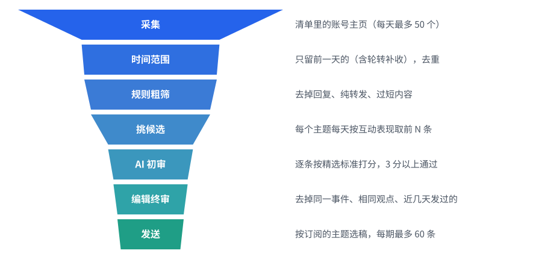

# 精选晨报（twitter-rss）

> 每天早上一封邮件，读完 AI 圈 100 位一线建设者昨天在 X（原 Twitter）上说了什么。

信息太多，值得读的太少。与其刷几百条推文，不如关注真正在做事的人：发布模型的实验室、写代码的研究者、做产品的开发者，
只看他们昨天分享的新东西、真实经验和有见地的判断。

精选晨报每天替你看一遍：由脚本连接一个采集专用的 Chrome 采集博主前一天的推文（也可以交给 Claude Code、Codex、DeepSeek Harness 等 AI Agent 在浏览器里采集），
大模型按你写下的标准逐条精选、翻译、摘要，按主题整理成一封邮件发给订阅者，同时提供 RSS。

## 你会收到什么

每天早上一封按主题分区的邮件，默认最多 60 条，按评分排序；一封放不下时分成几封发送（标题注明 1/2、2/2）：

- **完整的推文**：长文全文、作者的连续推文（Thread）合并、引用推文、图片，不用跳转 X 也能读完
- **中文翻译**：可选中文或原文阅读；选原文时 AI 摘要也用推文原来的语言
- **AI 摘要和要点**：超过 300 字的长推文和 Thread 先给一句结论和要点、原文折叠；较长的引用推文、外部文章（如官方技术博客）附概要和 2–4 条要点
- **评分和类型**：最佳实践、真实问题、新发布、应用案例、行业趋势、专家思考
- **主题标签页**：苹果邮件、163 等可以点标签切换主题；不支持的邮箱自动按主题依次排列
- **订阅页和 RSS**：订阅者自己选主题和语言，每个主题都有 RSS 地址（`/feed/<主题>.zh.xml`）

## 快速开始

需要 Node.js 22+、pnpm、Chrome，以及一个用来采集的 X 账号（建议用专用账号）。

```bash
git clone <仓库地址> twitter-rss && cd twitter-rss
pnpm install
cp .env.example .env     # 填大模型 API Key、QQ 邮箱 SMTP 授权码等，可以先留空试跑
pnpm db:migrate          # 建表
pnpm email:preview       # 用示例数据渲染邮件 → data/out/preview-zh.html
pnpm dev                 # 订阅页 http://localhost:3000
```

然后准备采集用的 Chrome，试采几个账号，再完整跑一次每日任务：

```bash
pnpm crawl:chrome             # 用独立资料（~/.xrss-chrome）打开采集专用的 Chrome，在里面登录采集用的 X 账号
pnpm crawl:auto --trial 5     # 试采 5 个账号，结果放在 data/trial/，不影响正式进度
scripts/daily-auto.sh         # 网络自检 → 采集清单 → 采集 → 精选 → 发信
```

没配 SMTP 时邮件不会真的发出，确认链接会打印在终端。

## 每天自动运行

默认用脚本版：`scripts/daily-auto.sh` 由 launchd 每天 08:00 启动（[`agents/com.xrss.auto.plist`](agents/com.xrss.auto.plist)），
依次做网络自检（WireGuard）、`pnpm plan` 生成采集清单、`pnpm crawl:auto` 采集、`scripts/daily.sh` 精选并发信，出问题时给 `ADMIN_EMAIL` 发提醒。
安装和各种情况的处理见 [脚本版每日任务](docs/scheduling/script-mode.md)。

备用方式是把"操作浏览器"交给能运行命令、能操作浏览器的 Agent（Claude Code、Codex、DeepSeek Harness 等），提示词在 [`agents/daily-task.md`](agents/daily-task.md)，
接入方式见 [Agent 版每日任务](docs/scheduling/agent-mode.md)。两种方式共用同一份清单和进度，同一天不要同时运行。

## 修改设置

所有设置都是 `config/` 下的纯文本文件，改完下次运行生效：

| 文件 | 管什么 |
|---|---|
| `config/topics.yaml` | 主题和博主（只采集这里列出的账号） |
| `config/digest.yaml` | 每期条数、送评审的条数、最低分、视频和个别账号降权、语言、邮件大小和分卷、合并发送 |
| `config/crawl.yaml` | 采集节流：每天账号数（默认 50）、节奏、活跃时段、异常后的冷却期 |
| `config/curation.md` | 精选标准，原样放进给大模型的提示词；想多看什么、少看什么直接改它 |
| `.env` | 大模型接口、SMTP、网站地址、管理后台密码、管理员提醒邮箱、WireGuard 隧道名 |

大模型默认用 DeepSeek（`deepseek-flash`），支持 Anthropic 和 OpenAI 两种接口格式，可以换成 Claude、GPT、Kimi、通义千问、智谱 GLM 或本地 Ollama 等。
全部配置项见 [配置参考](docs/maintenance/configuration.md)；改了精选标准后怎么验证见 [AI 精选](docs/features/curation.md#精选报告和重新评审)。

## 默认博主

默认跟踪司徒K《2026 年 X 上最值得关注的 100 个 AI 博主》里的 100 个账号，合并为 5 个主题：实验室与官方发布、研究者与深度观点、AI 编程、Agent 与开源、中文圈｜行业解读与产品出海、中文圈｜开发实践与内容创作。
完整名单和修改方法见 [默认博主](docs/features/accounts.md)，配置在 [`config/topics.yaml`](config/topics.yaml)。

## 工作原理

每天从采集到发送是一个逐层过滤的漏斗（宽度只表示大致比例）；虚线的人工反馈不过滤内容，用来持续调整精选标准：

<p align="center"></p>

1. **生成清单**：`pnpm plan` 按账号质量（近 14 天的通过率）和上次采集时间挑出今天要采的账号
2. **逐步采集**：`pnpm crawl:auto`（或 Agent 循环运行 `pnpm crawl next` / `pnpm crawl done`）按清单逐个打开主页、保存 X 的网络响应，按 X 返回的接口额度控制节奏，中断后从断点继续
3. **入库**：解析、去重、合并 Thread 和长文全文
4. **规则粗筛**：去掉回复、纯转发、过短内容；按互动相对作者自己中位数打规则分
5. **AI 初审**：每个主题每天最多送 30 条，逐条判断类型和质量分（5 分制，3 分以上通过），同时翻译、写摘要
6. **编辑终审**：整批去掉重复事件、相同观点和最近几天发过的内容
7. **人工反馈**：管理员在后台"今日反馈"（`/admin/feedback/today`）的邮件预览里给每条内容点赞 / 踩，踩可以选原因、写说明；
   每隔几天用 `pnpm feedback --summary` 汇总，据此修改精选标准 `config/curation.md` 或给个别账号降权（`account_weight`），下一次评审生效。
   反馈不直接参与选稿，发给读者的邮件里也没有反馈按钮
8. **发信**：按每位订阅者的主题和语言挑选，相同组合合并成一封（密送）发送，并更新 RSS

管理后台（`/admin`，设置 `ADMIN_PASSWORD` 后开放）还可以查看订阅者、推送历史和重新推送，见 [订阅页与管理后台](docs/features/web-admin.md)。

## 环境要求

- Node.js 22+、pnpm
- Chrome 和一个采集用的 X 账号（建议专用账号）；脚本版用独立的 Chrome 资料，macOS 上由 launchd 定时
- 备用的 Agent 版另需一个能运行命令的 AI Agent（Claude Code、Codex、DeepSeek Harness 等）和 [Tencent Browser Skill](https://github.com/Tencent/BrowserSkill)
- 大模型 API Key：默认 DeepSeek，可换成任何兼容 Anthropic 或 OpenAI 接口、支持工具调用的服务
- 发信邮箱：默认 QQ 邮箱 SMTP（需要授权码）
- 上线时：本机常驻运行网站 + Cloudflare Tunnel，或 Turso 数据库 + 可部署 Next.js 的平台（如 Vercel），见 [上线部署](docs/maintenance/deployment.md)

## 隐私与安全

- **只读浏览**：采集端（脚本或 Agent）只打开清单里的主页和推文，不点赞、不转发、不关注、不回复、不发帖
- **慢、少、遇到问题就停**：每天限量、按人的节奏浏览，按 X 返回的接口额度控制节奏；采集用的接口遇到限流、验证码、登录失效立即停止并进入冷却期，不重试、不绕过
- **不对抗检测**：不改浏览器指纹、不换 IP 或代理、不轮换多个账号、不处理验证码
- **数据留在你这里**：推文和订阅者存在你自己的数据库；送给大模型的只有公开推文内容，订阅者邮箱不会发给大模型
- 请遵守 X 的服务条款，只用于个人或小范围阅读

## 文档

按主题分类的完整说明在 [docs/](docs/README.md)：

- **功能**：[默认博主](docs/features/accounts.md) · [采集（含节流、额度与熔断）](docs/features/collection.md) · [AI 精选](docs/features/curation.md) · [邮件与 RSS](docs/features/email.md) · [订阅页与管理后台](docs/features/web-admin.md)
- **调度**：[脚本版每日任务](docs/scheduling/script-mode.md) · [Agent 版每日任务](docs/scheduling/agent-mode.md)
- **维护**：[配置参考](docs/maintenance/configuration.md) · [日常运维](docs/maintenance/operations.md) · [上线部署](docs/maintenance/deployment.md) · [开发](docs/maintenance/development.md)
